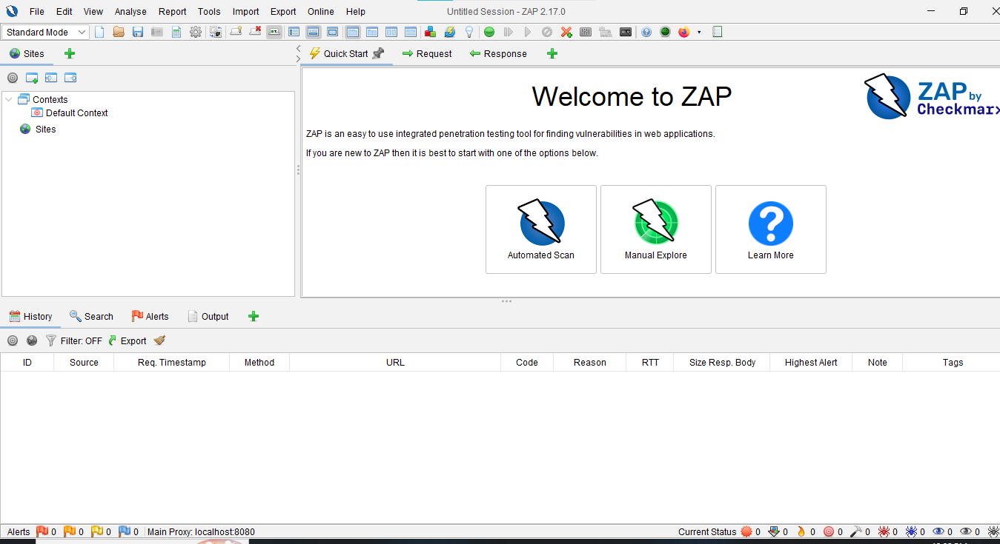
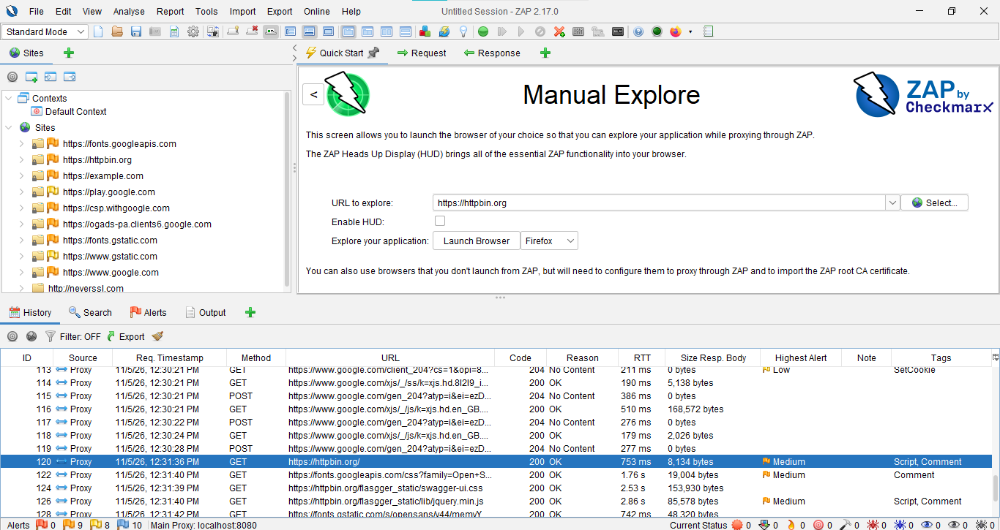
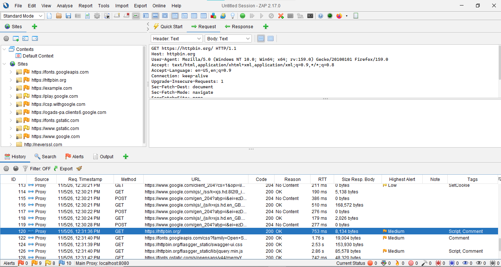
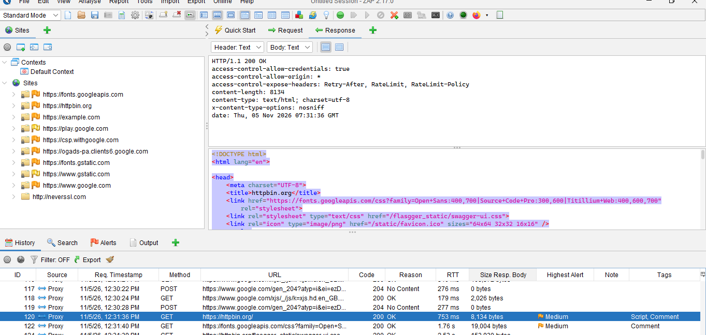

 Web Security Assessment Using OWASP ZAP

## 1. Objective

The objective of this task was to learn basic web application security assessment using OWASP ZAP. I explored web applications, observed HTTP requests and responses, performed a passive scan, identified security alerts, and learned basic security improvements.

## 2. Tools Used

1. OWASP ZAP – Web security testing tool.
2. Mozilla Firefox – Web browser.
3. Windows Operating System – Testing environment.
4. httpbin.org – Website used for exploring HTTP traffic.
5. neverssl.com – Website used for observing HTTP requests.

## 3. Work Completed

1. Opened OWASP ZAP on my computer.
2. Installed and configured Mozilla Firefox for browsing through ZAP.
3. Explored the target web applications using Firefox.
4. Observed HTTP requests and responses in the ZAP History tab.
5. Inspected HTTP request headers and response headers.
6. Performed passive scanning using OWASP ZAP.
7. Identified a Medium Risk security alert named CSP: Wildcard Directive.
8. Reviewed the alert description, evidence, other information, and recommended solution.

## 4. HTTP Request Analysis

I inspected HTTP traffic using the History tab in OWASP ZAP.

**Request Details:**

- Method: GET
- Host: neverssl.com
- Protocol: HTTP/1.1
- Browser: Mozilla Firefox

**Explanation:**

The GET method is used by a browser to request information from a web server.

The Host header identifies the target website, while the User-Agent header provides information about the browser.

## 5. HTTP Response Analysis

I inspected the server response in the Response tab.

**Response Details:**

- Status Code: 200 OK

**Explanation:**

HTTP 200 OK indicates that the server successfully processed the request and returned a response.

I also observed response headers and the HTML response body.

## 6. Security Alert Identified

**Alert Name:** CSP: Wildcard Directive

**Risk Level:** Medium

### Description

Content Security Policy (CSP) is an additional security layer that helps protect web applications against certain attacks, including Cross-Site Scripting (XSS) and data injection attacks.

OWASP ZAP identified that some CSP directives were missing or broadly defined.

### Affected Directives

- style-src
- img-src
- connect-src
- frame-src
- font-src
- media-src
- manifest-src
- worker-src

### Evidence

## Screenshots and Evidence

### 1. OWASP ZAP Main Interface

### 2. Target Website

### 3. HTTP Request

### 4. HTTP Response

### 5. Security Alerts

### 6. CSP Alert Evidence

The observed CSP policy included directives such as:

- object-src 'none'
- base-uri 'self'
- script-src with nonce and other source expressions.

### Impact

Broadly defined or missing CSP directives may reduce protection against certain content injection attacks.

### Recommendation

The website administrator should configure a strict Content-Security-Policy header and allow only trusted sources for scripts, images, styles, fonts, and other content.

**Note:** This is a passive-scan finding. It does not by itself prove that the website is exploitable.

## 7. Security Improvements

The following security improvements are recommended:

1. Configure a strict Content Security Policy.
2. Allow content only from trusted sources.
3. Avoid unnecessarily broad wildcard source permissions.
4. Regularly review HTTP security headers.
5. Perform regular security assessments.

## 8. Screenshots and Evidence

The following screenshots demonstrate the work completed during this task:

1. OWASP ZAP main interface.
2. Target website opened in Firefox.
3. HTTP Request captured in ZAP.
4. HTTP Response showing 200 OK.
5. Security Alerts tab showing CSP: Wildcard Directive.
6. CSP alert details showing Evidence and Other Info.

## 9. Learning Outcomes

During this task, I learned:

1. How to use OWASP ZAP for basic web security assessment.
2. How to capture and inspect HTTP requests and responses.
3. The meaning of HTTP status code 200 OK.
4. How to identify security alerts through passive scanning.
5. The importance of Content Security Policy in web security.

## 10. Conclusion

I successfully completed a basic web security assessment using OWASP ZAP. I explored web applications, inspected HTTP traffic, performed a passive scan, and identified a Medium Risk CSP: Wildcard Directive alert.

This task improved my understanding of web application security, HTTP communication, security headers, and basic security recommendations.

## Disclaimer

This practical work was performed for educational purposes as part of the Tamkeen NextGen Cyber Security Internship.

